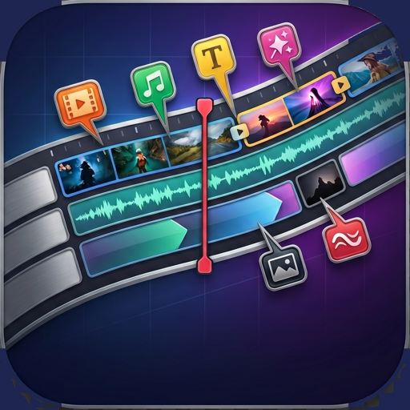
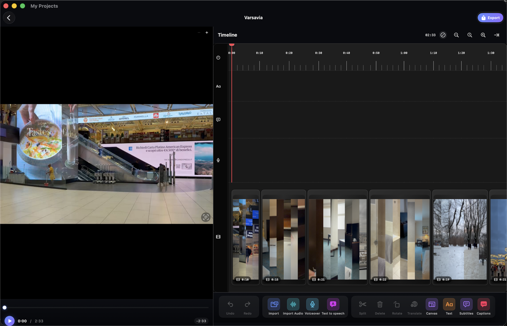
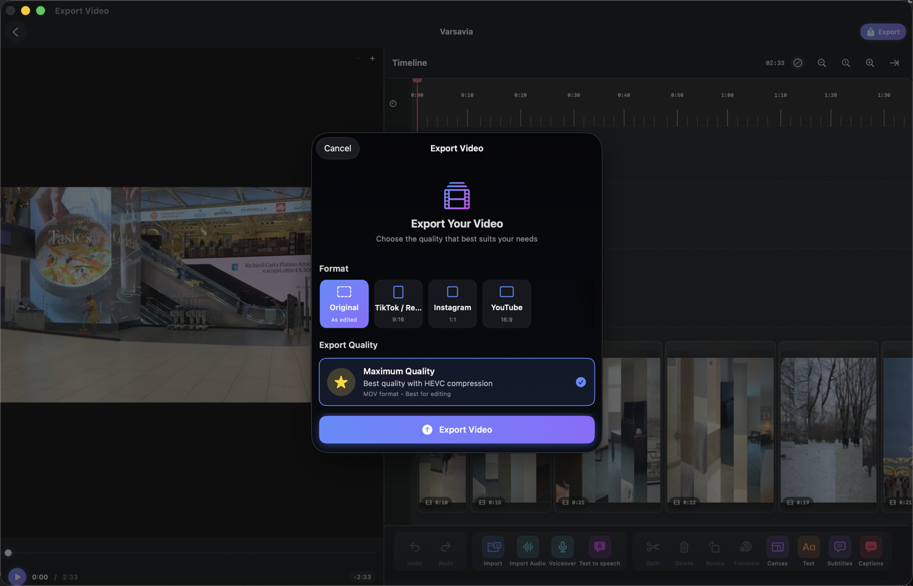
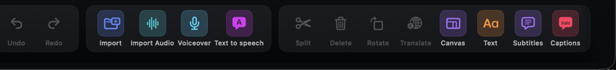

# Klipzen

  

<h3 align="center">Klipzen</h3>

  <b>A free, native video editor for Mac — trim, style, caption, and export in minutes.</b>

  
  
  
  
  
  
  

  

---

Klipzen is a fast, native SwiftUI video editor for Mac — a free solution who just want to cut, style, and share a video without fighting a bloated timeline app. Import multiple clips, trim and reorder them, add filters, transitions, captions, and music, then export straight to TikTok, Instagram, or YouTube formats — all running locally on your Mac.

> [!NOTE]
> **Free & ad-free:** Klipzen is a personal, independent project. No subscriptions, no watermarks, no ads, no account required.

  ⭐ If Klipzen is useful to you, <a href="https://github.com/joemockdao/Klipzen/stargazers">starring the repo</a> helps other people find it.

---

## 🔒 Trust & Security (Apple Notarized)

* **Signed & Notarized**: Every release is signed with a valid Apple **Developer ID** and notarized by Apple's automated notary service, so it opens without security warnings on macOS.
* **On-Device Processing**: Video composition and export run entirely through Apple's native AVFoundation — your clips are never uploaded anywhere. Automatic subtitles, subtitle translation, and voice translation also run on-device via Apple's Speech and Translation frameworks (macOS 26+ for translation on Mac).
* **Closed-Source Notice**: This repository hosts precompiled releases only — the source code is private. Independent security audits are always welcome.

---

## 🚀 Key Features

### 🎬 Timeline Editing
Import multiple video clips from Photos, Files, or your library, arrange them on a multi-track timeline, and trim, split, reorder, or multi-select clips for batch actions (delete, mute, speed change). Full undo/redo history and autosave — pick up right where you left off.

### 🎨 Color Filters & Grading
Apply one of 11 built-in cinematic presets (Cinematic, Vintage, Atmospheric, B&W, Faded, Cold, Warm, Drama, Chrome, Sunset, Matte), or fine-tune brightness, contrast, saturation, and more with manual color grading sliders.

### ✂️ Transitions
Add Fade, Cross Dissolve, Slide, Wipe, or Zoom transitions between clips, with adjustable duration — live preview included.

### 🔤 Titles & Animated Captions
Drop in quick-start title, lower-third, subtitle, and badge presets, or fully customize text style and animation. Generate word-by-word animated captions (karaoke, pop, spotlight styles) automatically from speech.

### 🗣️ Auto Subtitles, Translation & Voice Dubbing
On-device speech recognition generates subtitles automatically from your video's audio. Translate subtitles into another language, or go further with **Voice Translation**: recognize the spoken audio, translate it, and generate a dubbed voiceover with natural-sounding voices — all without leaving the app.

### 🖼️ Photos to Video
Turn still photos into video clips with a smooth Ken Burns pan-and-zoom effect and crossfade transitions.

### 🫥 Face & Plate Blurring
Automatically track and blur faces or license plates across a clip to protect privacy before sharing.

### 🔊 Audio Tools
Import background music, record a voiceover, generate text-to-speech narration, fine-tune fade in/out, and duck music automatically under dialogue. Waveform preview included.

### 📐 Canvas & Aspect Ratio
Choose your canvas aspect ratio and background, then override it per export with one-tap presets for **TikTok/Reels (9:16)**, **Instagram (1:1)**, or **YouTube (16:9)** — without touching your original project.

### 📤 Flexible Export
Export at Maximum Quality (HEVC/MOV), High Quality (1080p/MP4), or Standard Quality (720p/MP4), and save straight to your Mac or Photos library.

---

## 📸 Screenshots

  

  

---

## 🛠️ Requirements & Installation

### Requirements
* **macOS 14.0** or later (macOS Sonoma and newer)
* **macOS 26.0** or later is required for the automatic subtitle translation and voice translation features specifically — everything else in the app works from macOS 14.0 up.
* Klipzen will ask for **Photos** access to import and save videos, and for **Microphone** / **Speech Recognition** access only if you record a voiceover or generate automatic subtitles.

### Installation
1. Download the latest `.dmg` from the [Latest Releases](https://github.com/joemockdao/Klipzen/releases/latest) page.
2. Open the DMG file and drag **Klipzen** into your **Applications** folder.
3. Launch the app and grant permissions when prompted.

---

## 🌍 Languages

Klipzen automatically follows your macOS system language:
* 🇮🇹 Italian
* 🇬🇧 English

---

## 📬 Feedback & Support

Found a bug or have a feature idea? Your feedback shapes Klipzen.
* **Open an issue**: [github.com/joemockdao/Klipzen/issues](https://github.com/joemockdao/Klipzen/issues)
* **Start a discussion**: [github.com/joemockdao/Klipzen/discussions](https://github.com/joemockdao/Klipzen/discussions)

### Other Apps by the Developer
* 🧹 [CleanMacJoe](https://github.com/joemockdao/CleanMacJoe) — Free macOS disk cleaner, duplicate finder, and app uninstaller.
* 🛌 [SleepRec](https://apps.apple.com/it/app/sleeprec/id1528754113) — Advanced sleep analysis and rest tracker.
* 📝 [JoeNote](https://apps.apple.com/it/app/joenote/id6738133424) — Sleek notes and reminders organizer.
* 🔗 [Linktree](https://linktr.ee/joemockdevmobile) — All my projects in one place.

---

## 📄 License

Free to use. This repository hosts precompiled releases only. Source code is not public.
